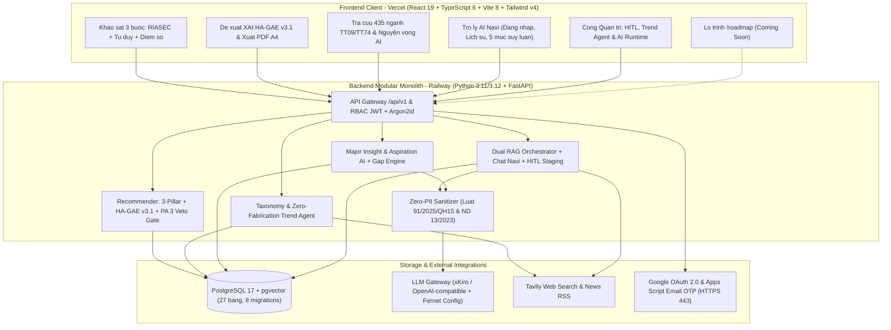

# AI CareerGuide — Hệ Thống Hướng Nghiệp & Đề Xuất Ngành Học XAI Cá Nhân Hóa

> **Capstone Project 1 (`CMU-SE 450` – Nhóm `C1SE.71`)** · International School, Duy Tan University (07/09/2026 – 20/12/2026)  
> Nền tảng tư vấn hướng nghiệp thuần túy giải thích được (**Explainable AI – XAI**) dành cho học sinh THPT Việt Nam, kết hợp mô hình toán học tất định 3 Trụ cột (**HA-GAE v3.1**), danh mục **435 ngành đào tạo cấp IV** chuẩn Bộ GD&ĐT (**Thông tư 09/2022/TT-BGDĐT** & **Thông tư 74/2026/TT-BGDĐT**) và trợ lý AI **Navi** tích hợp **Dual RAG (`pgvector`)**.

[](https://aicareerguide.tech/)
[](https://api.aicareerguide.tech/docs)
[](./LICENSE)

* **Ứng dụng Web (Production):** [https://aicareerguide.tech/](https://aicareerguide.tech/)
* **API Backend & Swagger Docs:** [https://api.aicareerguide.tech](https://api.aicareerguide.tech) · [Swagger UI (`/docs`)](https://api.aicareerguide.tech/docs)
* **Kho mã nguồn GitHub:** [https://github.com/DTU-C1SE-71/AI-CAREERGUIDE](https://github.com/DTU-C1SE-71/AI-CAREERGUIDE)
* **Hồ sơ & Tài liệu dự án (Google Drive):** [Thư mục tài liệu C1SE.71](https://drive.google.com/drive/folders/1_stC-6Y1rjGCJpCY3TQORdeRVLiuE_TO?usp=drive_link)
* **Giấy phép mã nguồn:** [MIT License](./LICENSE)

---

## 1. Tổng Quan Dự Án & Tính Năng Nổi Bật (Project Overview)

**AI CareerGuide** theo đuổi triết lý **tư vấn hướng nghiệp thuần túy (pure vocational guidance)**: đánh giá sự phù hợp ngành học dựa hoàn toàn trên sở thích nghề nghiệp, năng lực học tập và thiên hướng nhận thức của học sinh — không áp đặt thiên kiến học phí hay khu vực địa lý, đồng thời tách biệt hoàn toàn khâu tính điểm toán học khỏi rủi ro ảo giác (*hallucination*) của AI sinh.

### Các năng lực cốt lõi
* **Khảo sát đa chiều 3 bước kèm cổng kiểm soát hoàn tất:**
  1. **Sở thích (Holland RIASEC):** 30 câu hỏi Việt hóa sát bối cảnh học sinh THPT Việt Nam, đi kèm 30 hình minh họa cục bộ.
  2. **Tư duy (Cognitive Profiling):** 8 câu hỏi tình huống nhận thức và phong cách học tập.
  3. **Điểm số (Academic Profile):** Nhập điểm học bạ / điểm thi THPT theo từng môn và khối lớp (`Lớp 10`, `Lớp 11`, `Lớp 12`, `Đã tốt nghiệp cấp 3`), mở khóa gợi ý khi hoàn tất đầy đủ 3 bước.
* **Đề xuất XAI Tất định 3 Trụ Cột + HA-GAE v3.1:**
  * Tính điểm tất định $100\%$ tại Backend, trọng số thích ứng theo từng khối lớp (**Horizon-Adaptive Simplex Weights**).
  * Lõi xếp hạng **trung lập giới tính** (tuân thủ Luật Bình đẳng giới số 73/2006/QH11 & Bộ luật Lao động số 45/2019/QH14), đi kèm **lưu ý công thái học & an toàn nghề nghiệp** theo Thông tư 10/2020/TT-BLĐTBXH.
  * Tích hợp **PA 3 Sub-facet Veto Gate**, **Phễu 2 tầng (`REACH / TARGET / SAFETY`)**, ngưỡng sàn tuyển sinh Bộ GD&ĐT (`22.5 / 21.0 / 19.0 / 18.0 / 15.0`), giải thích **XAI 3 câu** và xuất báo cáo **PDF tiếng Việt khổ A4**.
* **Danh mục 435 ngành cấp IV (23 nhóm lĩnh vực):**
  * Chuẩn hóa theo **Thông tư 09/2022/TT-BGDĐT** và **Thông tư 74/2026/TT-BGDĐT**, hỗ trợ nhập chuẩn Excel (`MOET_Major_Import_Template_Standard.xlsx`).
  * Phân tích kỹ năng theo ngành có bộ nhớ đệm DB (`evidence-skills-v4`), **Aspiration Agent** (44 nghề nghiệp tiêu biểu) và đánh giá nguyện vọng AI (`/major-insights/aspiration-ai`).
* **Trợ lý AI Navi, Dual RAG (`pgvector`) & Trend Discovery Agent:**
  * Trợ lý **Navi** yêu cầu đăng nhập, lưu lịch sử hội thoại bền vững (`chat_sessions` / `chat_messages`), hỗ trợ 5 mức suy luận (`auto / low / medium / high / extra_high`).
  * Nạp tri thức 2 luồng (**Two-Stream Ingestion**): Luồng A (Văn bản pháp quy Bộ GD&ĐT + Vision OCR) và Luồng B (nguồn web chọn lọc qua Tavily/Jina có kiểm duyệt HITL).
  * **Zero-Fabrication Trend Discovery Agent** (Tavily + News RSS, ngưỡng kiểm chứng `evidence_score >= 2.0`, 99 nhóm từ đồng nghĩa) cập nhật xu hướng ngành dựa trên nguồn thực.
* **Lộ trình tự học (`/roadmap`):**
  * Dịch vụ Backend `gap_roadmap_engine` đã hoàn thiện động cơ phân tích lỗ hổng kỹ năng và sinh khung lộ trình có bộ nhớ đệm; giao diện học sinh `/roadmap` hiện hiển thị trạng thái **Coming Soon**.

---

## 2. Cơ Sở Toán Học & Thuật Toán XAI (3-Pillar + HA-GAE v3.1)

Điểm tương thích tổng hợp của học sinh $u$ với ngành đào tạo $m$ ($S(u, m) \in [0, 100]$) được tính hoàn toàn tất định tại Backend:

$$S(u, m) = 100 \times \left( w_1 \cdot S_{\text{RIASEC}}(u, m) + w_2 \cdot S_{\text{Academic}}(u, m) + w_3 \cdot S_{\text{Cognitive}}(u, m) \right)$$

* **Trọng số cơ sở (baseline):** $w_1 = 0.45$ (Sở thích RIASEC), $w_2 = 0.35$ (Năng lực học thuật), $w_3 = 0.20$ (Thiên hướng nhận thức).

### Trụ cột 1: Độ Tương Thích Sở Thích Holland RIASEC
Đo độ tương tự Cosine giữa vector sở thích của học sinh $\vec{v}_u$ và vector chuẩn hóa của ngành $\vec{v}_m$:

$$S_{\text{RIASEC}}(u, m) = \frac{\vec{v}_u \cdot \vec{v}_m}{\|\vec{v}_u\|_2 \|\vec{v}_m\|_2} = \frac{\sum_{d \in \{R,I,A,S,E,C\}} v_{u,d} \cdot v_{m,d}}{\sqrt{\sum v_{u,d}^2} \sqrt{\sum v_{m,d}^2}}$$

### Trụ cột 2: Năng Lực Học Thuật & Phân Phối Chuẩn Z-Score
Chuẩn hóa điểm từng môn qua phân phối Z-Score và hàm phân phối tích lũy chuẩn $\Phi(Z_{u,s})$, sau đó chọn tổ hợp môn xét tuyển $b \in B_m$ có điểm trung bình cao nhất của ngành $m$:

$$Z_{u,s} = \frac{X_{u,s} - \mu_s}{\sigma_s}, \quad S_{\text{Academic}}(u, m) = \max_{b \in B_m} \left( \frac{1}{|b|} \sum_{s \in b} \Phi(Z_{u,s}) \right)$$

### Trụ cột 3: Thiên Hướng Nhận Thức & Phong Cách Học Tập
Áp dụng ma trận quy tắc đối chiếu giữa đặc trưng tư duy của học sinh và yêu cầu nhận thức của ngành:

$$S_{\text{Cognitive}}(u, m) = \frac{1}{|K|} \sum_{k \in K} M_k(\text{student\_pref}_k, \text{major\_req}_{m,k})$$

### Bảng Trọng Số Thích Ứng Theo Khối Lớp — HA-GAE v3.1
Thuật toán **HA-GAE v3.1** (`backend/app/services/recommender/horizon_gender_engine.py`) tự động điều chỉnh simplex trọng số và cơ cấu Phễu 2 tầng theo mốc thời gian trước kỳ thi của học sinh:

| Khối lớp | Hệ số thời gian ($\tau$) | $w_{\text{RIASEC}}$ | $w_{\text{Academic}}$ | $w_{\text{Cognitive}}$ | $\Delta_{\text{reach,max}}$ | Tỷ lệ Phễu (REACH / TARGET / SAFETY) |
| :--- | :---: | :---: | :---: | :---: | :---: | :---: |
| **Lớp 10** | `1.00` | `0.500` | `0.250` | `0.250` | `3.5` | `40% / 40% / 20%` |
| **Lớp 11** | `0.65` | `0.465` | `0.320` | `0.215` | `2.6` | `30% / 50% / 20%` |
| **Lớp 12** | `0.25` | `0.425` | `0.400` | `0.175` | `1.2` | `15% / 65% / 20%` |
| **Đã tốt nghiệp cấp 3** | `0.15` | `0.415` | `0.420` | `0.165` | `1.0` | `10% / 60% / 30%` |

### Ngưỡng Sàn Bộ GD&ĐT & Cổng Chặn PA 3 Sub-facet Veto Gate
* **Ngưỡng sàn xét tuyển theo nhóm ngành:** Áp dụng các mốc điểm sàn `22.5`, `21.0`, `19.0`, `18.0`, `15.0` để phân tầng cơ hội trúng tuyển trong Phễu 2 tầng (`REACH`, `TARGET`, `SAFETY`).
* **PA 3 Sub-facet Veto Gate:** Kiểm tra xung đột sâu ở mức tiểu khía cạnh (*sub-facet*) giữa hồ sơ học sinh và đặc thù ngành học; khi kích hoạt `STRONG_VETO`, kết quả phân tích nguyện vọng AI bị khóa ở mức phù hợp `LOW` và chỉ gợi ý các ngành thay thế thuộc danh mục mã 7 chữ số thực của Bộ GD&ĐT.

---

## 3. Kiến Trúc Hệ Thống & Công Nghệ (Architecture & Tech Stack)



### Công nghệ sử dụng (Tech Stack)

| Tầng hệ thống | Công nghệ & Phiên bản chính |
| :--- | :--- |
| **Frontend (`frontend/package.json`)** | React `19.3`, TypeScript `6.0`, Vite `8.3`, Tailwind CSS `v4.3`, React Router `v7`, TanStack Query `v5`, Recharts `v3`, Framer Motion, `@xyflow/react`, `@react-oauth/google`, `html2canvas` + `jsPDF` (PDF tiếng Việt A4), `xlsx`, `oxlint`, Playwright E2E |
| **Backend (`backend/requirements.txt`)** | Python `3.11 / 3.12`, FastAPI `>=0.111`, SQLAlchemy `2.0 Async` (`asyncpg` / `aiosqlite`), Pydantic `v2`, `pgvector` (`1536` chiều), `argon2-cffi`, `PyJWT`, `cryptography` (Fernet), `scipy`, `numpy`, `httpx`, `openai` SDK, `tavily-python`, `openpyxl`, `pypdf` |
| **Database & Migration** | PostgreSQL `17` (`pgvector/pgvector:pg17` trên Railway), 27 bảng hoạt động qua 8 migration có phiên bản (`20261116_001_base` đến `20261128_008_db_architecture_cleanup`), hỗ trợ SQLite khi chạy cục bộ |
| **Hạ tầng triển khai** | Vercel (Frontend + `/api/*` rewrite proxy) · Railway (Backend Docker container + PostgreSQL `pgvector`) |

---

## 4. Cấu Trúc Thư Mục & 8 Dịch Vụ Backend

```text
AI_CAREERGUIDE/
├── .githooks/                    # Hook commit-msg kiểm tra Conventional Commits
├── .github/                      # GitHub Actions CI & Pull Request template
├── backend/
│   ├── app/
│   │   ├── core/                 # Cấu hình môi trường, bảo mật, exception, database session
│   │   ├── db/                   # ORM models & 8 versioned migrations (27 bảng)
│   │   ├── modules/assessment/   # Đề câu hỏi khảo sát RIASEC (30) & Nhận thức (8)
│   │   ├── schemas/              # Pydantic schemas
│   │   └── services/             # 8 dịch vụ nghiệp vụ mô-đun hóa
│   ├── scripts/                  # init_db.py, seed_catalog.py, create_admin.py, verify_taxonomy.py...
│   ├── tests/                    # 32 bộ kiểm thử tự động Pytest (test_*.py)
│   ├── Dockerfile                # Ảnh triển khai Backend cho Docker / Railway
│   ├── railway.toml              # Cấu hình triển khai Railway
│   └── requirements.txt
├── docs/                         # Báo cáo kiểm toán, engineering notes, kế hoạch phát triển
├── frontend/
│   ├── e2e/                      # 4 bộ kiểm thử đầu-cuối Playwright (.spec.ts)
│   ├── public/images/assessment/ # 30 hình minh họa khảo sát cục bộ
│   ├── src/                      # Pages, components, hooks, services, PDF generator
│   ├── tests/                    # 5 bộ unit test Frontend (.test.ts)
│   ├── package.json
│   └── vercel.json               # Rewrite /api/* sang Production Backend
├── .env.example                  # Mẫu biến môi trường chuẩn
├── docker-compose.yml            # Khởi chạy full-stack cục bộ (pgvector + backend + frontend)
├── pytest.ini
└── README.md
```

### Tóm tắt 8 dịch vụ trong `backend/app/services/`

| Dịch vụ | Vai trò chính |
| :--- | :--- |
| `identity` | Đăng ký/đăng nhập, Argon2id, JWT HS256, Google OAuth 2.0, OTP Email 6 chữ số (Apps Script HTTPS 443), RBAC (`STUDENT` / `ADMIN`), nhật ký đồng thuận pháp lý |
| `assessment` | Lưu trữ, kiểm tra hoàn tất 3 bước khảo sát (Sở thích RIASEC, Tư duy nhận thức, Học bạ/Điểm thi) và đồng bộ trạng thái sẵn sàng gợi ý |
| `recommender` | Bộ tính 3 Trụ cột, **HA-GAE v3.1**, **PA 3 Sub-facet Veto Gate**, Phễu 2 tầng (`REACH / TARGET / SAFETY`), **Aspiration Agent** (44 nghề nghiệp), giải thích XAI |
| `taxonomy` | Quản lý danh mục **435 ngành cấp IV (23 nhóm lĩnh vực)** theo TT09/2022 & TT74/2026, nhập chuẩn Excel và **Zero-Fabrication Trend Discovery Agent** |
| `major_insight` | Phân tích kỹ năng theo ngành có cache DB (`evidence-skills-v4`) và đánh giá nguyện vọng AI (`/major-insights/aspiration-ai`) |
| `gap_roadmap_engine` | Phân tích lỗ hổng năng lực và khung lộ trình học tập (đã sẵn sàng ở Backend; UI `/roadmap` đang gắn nhãn `Coming Soon`) |
| `llamaindex_rag_orchestrator` | Nạp tri thức 2 luồng (Thông tư + Web), hàng đợi kiểm duyệt HITL có khóa bản ghi, Dual RAG `pgvector`, trợ lý AI **Navi** kèm lịch sử chat |
| `ai_config` | Quản trị cấu hình AI Runtime (`ENV` / DB mã hóa Fernet), CAS revision control, chống SSRF, ẩn hoàn toàn khóa bí mật (`reveal_supported=False`) |

---

## 5. Hướng Dẫn Cài Đặt & Chạy Cục Bộ (Quickstart Guide)

### Yêu cầu môi trường
* **Python:** `3.11` hoặc `3.12`
* **Node.js:** `20+`
* **Cơ sở dữ liệu:** PostgreSQL `16` / `17` có extension `pgvector` (hoặc dùng Docker Compose; khi phát triển cục bộ không cấu hình Postgres, hệ thống tự dự phòng SQLite tại `backend/app/db/careerguide_active.db`).

### Bước 1: Clone kho mã nguồn & cấu hình biến môi trường
```bash
git clone https://github.com/DTU-C1SE-71/AI-CAREERGUIDE.git
cd AI-CAREERGUIDE
cp .env.example .env
```
Mở `.env` (tham khảo chi tiết tại [.env.example](./.env.example)) và cấu hình các biến tối thiểu (`SECRET_KEY`, `DATABASE_URL`, `AI_CONFIG_ENCRYPTION_KEY`, `LLM_API_KEY`...).

### Bước 2A: Khởi chạy nhanh bằng Docker Compose (Khuyên dùng)
```bash
docker compose up --build
```
Lệnh trên khởi động container PostgreSQL + `pgvector`, tự động chạy `python scripts/init_db.py`, khởi chạy Backend ở cổng `8000` và Frontend ở cổng `5173`.

### Bước 2B: Khởi chạy thủ công Backend & Frontend

**Backend (FastAPI):**
```bash
python -m venv venv
# Windows PowerShell:
.\venv\Scripts\activate
# Linux / macOS:
# source venv/bin/activate

pip install -r backend/requirements.txt

# Khởi tạo schema (27 bảng / 8 migrations) & nạp danh mục ngành Bộ GD&ĐT
python backend/scripts/init_db.py
python backend/scripts/seed_catalog.py
# Tùy chọn: tạo tài khoản quản trị viên
python backend/scripts/create_admin.py

uvicorn app.main:app --app-dir backend --host 127.0.0.1 --port 8000 --reload
```

**Frontend (Vite + React 19):**
```bash
cd frontend
npm install
npm run dev -- --host 127.0.0.1 --port 5173
```

### Địa chỉ truy cập cục bộ
* **Giao diện người dùng:** `http://127.0.0.1:5173`
* **Swagger UI:** `http://127.0.0.1:8000/docs`
* **ReDoc:** `http://127.0.0.1:8000/redoc`
* **Kiểm tra kết nối CSDL:** `http://127.0.0.1:8000/health/db`

---

## 6. Kiểm Thử & Đảm Bảo Chất Lượng (Testing & Verification)

Kho mã nguồn tổ chức kiểm thử ở cả tầng Backend, Frontend Unit Test, kiểm tra tĩnh và E2E:

| Hạng mục | Phạm vi trong repo | Lệnh thực thi |
| :--- | :--- | :--- |
| **Backend Pytest** | `32` tệp kiểm thử (`backend/tests/test_*.py`) bao phủ thuật toán 3 Trụ cột, HA-GAE v3.1, PA 3 Veto Gate, Dual RAG, bảo mật & migration | `pytest` |
| **Frontend Unit Tests** | `5` tệp kiểm thử (`frontend/tests/*.test.ts`) | `cd frontend && npm test` |
| **Lint, Typecheck & Build** | `oxlint`, `tsc -b` và `vite build` | `cd frontend && npm run lint && npm run typecheck && npm run build` |
| **Playwright E2E** | `4` kịch bản kiểm thử trình duyệt (`frontend/e2e/*.spec.ts`) | `cd frontend && npm run test:e2e` |

---

## 7. Bảo Mật, Quyền Riêng Tư & Quản Trị AI

* **Tuân thủ Luật Bảo vệ dữ liệu cá nhân số 91/2025/QH15 & Nghị định 13/2023/NĐ-CP:** Lưu vết đồng thuận thu thập dữ liệu khi đăng ký; mọi văn bản trước khi đưa vào RAG hoặc gửi tới LLM Gateway đều đi qua bộ lọc **Zero-PII Regex Sanitizer** để loại bỏ email, số điện thoại và định danh cá nhân.
* **Bảo mật xác thực:** Mật khẩu băm bằng **Argon2id** (`t=3, m=64MiB, p=2`); phiên làm việc dùng JWT (`HS256`); hỗ trợ Google OAuth 2.0 và OTP Email 6 chữ số qua Google Apps Script Webhook (`HTTPS 443`).
* **Quản trị AI an toàn:** Khóa cấu hình AI mã hóa bằng **Fernet** ở tầng lưu trữ, vô hiệu hóa đọc ngược API key (`reveal_supported=False`), kiểm soát xung đột ghi bằng CAS revision, chặn SSRF khi cấu hình LLM Base URL, áp dụng hàng rào 3 lớp chống Prompt Injection, phân quyền RBAC (`STUDENT` / `ADMIN`) và kiểm duyệt HITL có khóa bản ghi.

---

## 8. Triển Khai Production (Production Deployment)

Hệ thống hiện đang vận hành trên hạ tầng **Vercel** và **Railway**, đồng bộ tự động từ nhánh `main` của kho lưu trữ `DTU-C1SE-71/AI-CAREERGUIDE`:

| Thành phần | Nền tảng | Địa chỉ / Trạng thái kiểm tra |
| :--- | :--- | :--- |
| **Frontend Web** | **Vercel** (`ai-careerguide`) | [https://aicareerguide.tech/](https://aicareerguide.tech/) · Proxy `/api/*` -> [kiểm tra `/api/health/db`](https://aicareerguide.tech/api/health/db) |
| **Backend API** | **Railway** (`ai-careerguide-backend`, root `/backend`) | [https://api.aicareerguide.tech](https://api.aicareerguide.tech) · [kiểm tra `/health/db`](https://api.aicareerguide.tech/health/db) |
| **Vector Database** | **Railway PostgreSQL 17 + `pgvector`** (`pgvector/pgvector:pg17`) | 27 bảng hoạt động, 8 migration đã đồng bộ |

---

## 9. Quy Trình Git Flow, Nhóm Tác Giả (C1SE.71) & Bản Quyền

### Quy trình Git Flow & Conventional Commits
* `main`: Nhánh phát hành ổn định, đồng bộ trực tiếp với môi trường Production (Vercel & Railway).
* `develop`: Nhánh tích hợp tính năng trước khi kiểm thử phát hành.
* `feature/*`, `bugfix/*`, `release/*`, `hotfix/*`: Nhánh công việc theo quy ước Git Flow, hợp nhất qua Pull Request ([PR Template](./.github/pull_request_template.md)).
* Thông điệp commit tuân thủ **Conventional Commits** (`feat`, `fix`, `refactor`, `docs`, `test`, `chore`, `style`, `perf`) và được kiểm tra tự động bởi hook [`.githooks/commit-msg`](./.githooks/commit-msg).

### Nhóm tác giả — Capstone Team C1SE.71 (Duy Tan University)
* **Giảng viên hướng dẫn (Academic Mentor):** MSc. Sơn, Phan Văn (`sonpvs@duytan.edu.vn`)

| MSSV | Họ và tên | Vai trò | Email |
| :--- | :--- | :--- | :--- |
| `29211142148` | **Nguyễn Tấn Duy** | Scrum Master / Project Leader & Backend Lead | `nguyentduy.025@gmail.com` |
| `29212736855` | **Nguyễn Tam Trung** | System Architect / Full-Stack | `tamtrung3666@gmail.com` |
| `29214360592` | **Nguyễn Tư Cường** | Product Owner / BA & QA Lead | `tucuong37k5@gmail.com` |
| `29219030682` | **Nguyễn Thái Hoàng Hiếu** | Frontend Lead / UI-UX | `nguyenthaihoanghieu3012005@gmail.com` |
| `29219065409` | **Nguyễn Thanh Long Hiển** | AI, RAG & Data Engineer | `hiennguyen05102005@gmail.com` |

Phát hành theo giấy phép **[MIT License](./LICENSE)**.
